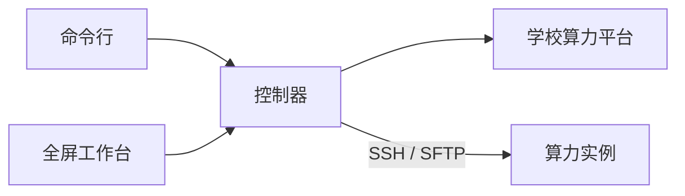

# bupt · 北邮算力命令行

北邮师生可以用校园账号在终端申请 GPU、通过 SSH 连接实例，也可以试用学校提供的模型 API，查看价格和用量。

[](https://github.com/ppppangu/bupt-cli/releases/latest)
[](go.mod)
[](LICENSE)

<a id="安装"></a>

## Quick Start · 安装

在 macOS、Linux 或 WSL2 的终端运行（支持 x86_64 和 arm64）。[使用指南](https://bupt-cli.gitbook.io/bupt-cli-docs/) · [离线安装说明](packaging/使用说明.txt)

```sh
curl -fsSL https://github.com/ppppangu/bupt-cli/releases/latest/download/install.sh | sh
```

装好后，在新终端运行以下命令。首次打开时按界面提示设置工作区，扫码登录学校账号。

```sh
bupt tui
```

## Usage · 常用命令

| 我想做什么 | 登录后运行 |
| --- | --- |
| 查有哪些模型、能做什么、怎么计费 | `bupt api model` |
| 试用模型，或生成 Python、curl 调用示例 | `bupt tui api` |
| 选 GPU 规格、核对日价并申请实例 | `bupt tui compute` |
| 查自己的实例和运行状态 | `bupt compute instance` |
| 查最近 7 天的模型用量和算力账单 | `bupt usage --days 7` |

在脚本里运行 `bupt api model --output id`，每行返回一个模型 ID。Pi、Codex 和 Claude Code 用 `bupt login --agent` 获取扫码图片。[Agent 登录](docs/guide/agents.md) · [脚本输出与退出码](docs/usage.md#脚本契约与命令迁移) · [作业与文件传输](docs/guide/jobs.md)

## 从申请 GPU 到连接 SSH

在工作台选规格、核对日价和运行时限。实例就绪后，从详情页进入 SSH。退出 SSH 后即可回到详情页停机。


演示使用模拟学校数据。[在线调试模型](docs/demo/assets/tui-model.gif) · [生成 Python 和 curl 示例](docs/demo/assets/tui-integration.gif) · [命令行操作](docs/demo/assets/cli-demo.gif)

<details>
<summary>源码构建与测试</summary>

在仓库根目录使用 Go 1.26.0 或更高版本及 Make。构建产物为 `build/bupt`。

```sh
make build
make test
make vet
```

命令行与工作台共用控制器。默认在本机运行，也可以配置远程控制器。



[架构](docs/architecture.md) · [控制器协议](docs/protocol.md) · [构建与分发](docs/releasing.md) · [演示录制与验证](docs/demo/README.md)

</details>

## 联系作者与问题反馈

<!-- feedback-contact:start -->
**联系邮箱** [meidici911@gmail.com](mailto:meidici911@gmail.com)
<!-- feedback-contact:end -->

请附上出错的命令、发生时间和错误信息。可用 `bupt feedback --template` 生成反馈正文，或在工作台选择「帮助与反馈」。发送前请移除密码、完整 API Key、令牌和私钥。[详细手册](docs/usage.md) · [常见问题](docs/guide/troubleshooting.md)

bupt 是第三方工具，与学校及「人人有算力」平台无隶属或委托关系。请使用自己的账号和配额，遵守平台规定。登录会话和 API Key 加密保存在所选控制器上，计费、审批和权限由学校管理部门处理。
