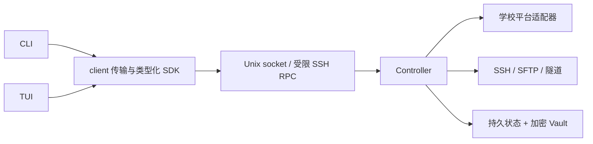

# CLI 与 TUI 的信息结构

不带参数的 `bupt` 输出命令索引。全屏界面由 `bupt tui` 打开，两种入口共享业务对象、控制器和权限检查。

- **大模型 API 服务**汇集模型目录、调用、用量、密钥、接入示例与排行榜。协议层将门户返回的数据转换为带类型的值，终端负责表格、单位、滚动和筛选。代码示例和实际发送共用同一个模型及输入草稿。
- **裸算力服务**把资源组织为「我的工作」「资源与申请」「存储与数据」「项目与费用」。分组展开和筛选只操作本地行。用户选定实例、项目、资源或作业后才出现相应操作。目录和详情使用平台对象 ID。
- **账号状态与配置**汇集学校认证、控制器、连接、顶栏偏好、动态和协议。顶栏使用控制器发布的账号状态，和资源详情的读取、表单的编辑分别更新。
- **教程说明**和 `bupt help tutorial` 共享离线教程。Cobra 生成 CLI 帮助。TUI 自己定义操作入口、表单字段和导航。

`internal/tui` 使用 tcell 管理终端。页面栈保留父页的选择、筛选和滚动位置，刷新时按对象 ID 恢复选择。后台读取返回事件到单一 UI 循环，离开的页面取消请求，过期响应按请求代数丢弃。浏览期间按需加载目录和详情。显示活跃 Run 的详情时定期读取本地回执。交互操作复用同一 profile 的控制器和已有终端处理函数。

页面显式声明哪些行是导航入口。方向键只能打开这些入口或展开分组，提交、启停和模型调用由对应操作项处理。正文的滚动位置与操作焦点分别保存，读到文末可以选择后续动作。受保护的读取记录自己的认证或协议要求，恢复后重读该页面。调用表单单独持有草稿，刷新账号、切换页面和准备 Key 都能回到当前输入。



| 边界 | 负责 | 前端不能接管的工作 |
| --- | --- | --- |
| `internal/domain` | 类型化请求、Run/Task/Route/认证回执、稳定错误码 | 不依赖 Cobra、终端、浏览器或控件 |
| `internal/client` | 同一 RPC 通路的类型化调用、取消等待、字节流 | 不自动创建、接管、续期或重新登录 |
| `internal/control` | 认证状态机、权限、幂等意图、生命周期协调 | 前端不能直接改数据库来替代操作 |
| `internal/platform` / `internal/connect` | 学校协议与独立 SSH 通路 | 不把 provider 流程复制进 TUI |
| `internal/cli` / `internal/tui` | 输入、确认、配置选择、渲染、终端管理 | 不解析 CLI 文本输出来判断业务结果 |

每个 profile 的操作都发送到其选定控制器。多个前端共享这一份状态；不让本地和远程控制器同时托管同一实例。采用“本地控制器 + 远程中继”时，远程服务承担租约与转发，本地控制器仍是该 Run 的管理者。前端不设置 RPC `client_id`；远程网关根据注册 SSH 身份写入它。

请求类型见 [requests.go](../internal/domain/requests.go)，查询/认证接口见 [sdk.go](../internal/client/sdk.go)，变更接口见 [operations.go](../internal/client/operations.go)。`Client.Call` 仍可承载尚未增加类型化封装的 RPC；业务规则始终留在控制器。

| 用户动作 | SDK / RPC | 成功回执 |
| --- | --- | --- |
| 配额和按资源池归集的模板目录 | `resources.overview` | `ResourceOverview` |
| 总览（不自动登录）、恢复等待 | `Status` / `WaitRun` | `StatusReport` / `Run` |
| 校验资源预设（无分配） | `preset.resolve` | `Preset` |
| 登录、继续等待批准 | `StartLogin` / `PollLogin` | `AuthChallenge` |
| 创建、启动、恢复、明确接管、克隆 | `instance.*` | `Run` |
| 提交作业、结束周期、取消作业 | `RunJob` / `Down` / `CancelJob` | `Run` |
| 修改现有周期策略 | `UpdateRunPolicy` → `lease.set` | 带新 `PolicyRevision` 的 `Run` |
| 原子停机、释放、删除、资源/快照/服务操作、申请续期 | 对应类型化方法 | `TaskRecord` |
| 预览上述变更 | `Preview(ctx, method, request)` | 原始 JSON，形状依操作而异 |
| 应用可信配置 | `ReloadConfiguration` → `agent.reload` | `ReloadResult` |

托管的 create/start/restore 返回 Run，不能当成一次平台 Task。预览也不能当成已执行的 Run/Task：有的返回拟议 Run，有的返回请求体或操作说明；预览不保证执行时状态、额度或权限仍相同。

前端状态应分开保存：当前选中 ID、表单、待提交动作、已收到的 Run/Task/Route、认证 challenge、最近错误。`Run.State`、`AuthState`、`RenewalState`、`CleanupState`、`ExitCode` 是独立事实。例如“学校认证待刷新、SSH 可用、释放待认证”可以同时成立；不合并成一个“离线”状态。完成操作后按返回 ID 重新读取状态，不凭按钮点击、RPC 返回或任务队列受理就显示“已释放”。

认证界面提供扫码和统一认证账号密码两项。选择后复用前台登录流程。该流程调用 `StartLogin`，扫码期间按 `PollAfterMS` 安排 `PollLogin`，密码表单等待人工输入后以表单 ID 调用 `SubmitLoginPassword`，展示 `Stage`、`State`、`RequiredAction`、URL 与有效期。`webvpn → university_sso → complete` 的切换由控制器完成；前端不自行拼接第二阶段登录。接管其他 WebVPN 登录等人工决定必须由用户触发相应动作。遇到未知 action/stage 保留提示和原始状态，不猜测或自动批准。

TUI 的事件循环只发起异步请求并接收结果；关闭页面取消请求/日志订阅的 context。**取消等待不会取消后台 Run**；停止作业必须明确调用 `CancelJob` 或 `Down`。RPC 超时与 `TASK_PENDING` 也不代表执行失败：保留业务回执和幂等键，按 `task_id` / Run ID 继续查询；不能换一个键盲目重建。界面按 `domain.Error.Code` 选择动作，`Message` 只用于展示。

创建按钮可以直接构造请求，无需模拟命令行：

```go
wait, renew := false, false
maxRuntime := "2h"
request := domain.ManagedRequest{
    OperationOptions: domain.OperationOptions{
        Wait: &wait, IdempotencyKey: operationID, // 本次用户意图的稳定键
    },
    PolicySelection: domain.PolicySelection{
        MaxRuntime: &maxRuntime,
        Policy: &domain.RunPolicyPatch{AutoRenew: &renew},
    },
    TemplateSelection: domain.TemplateSelection{SpecID: selectedSpecID},
    Name: instanceName,
    MaxPointsPerDay: authorizedRate,
}
run, err := api.CreateInstance(ctx, request)
// 将结果交回事件循环；成功后用 run.ID 调用 GetRun。
```

指针字段的 `nil` 表示“不改/沿用默认”，`&false` 表示明确关闭。CLI、SDK 和 TUI 共用 `auto_renew=false` 的内置默认；只有显式配置或操作才启用续期，并且仍须有有限截止时间。SDK 不自动补 `Adopt=true`；选中已有实例不等于同意接管。`MaxRuntime` 和 `Until` 每次只选一个，并位于请求顶层，使控制器清除旧的限时方式；`RunPolicyPatch` 只携带实际修改的其他字段。编辑已有 Run 时附上展示时的 `PolicyRevision`，收到 `POLICY_CONFLICT` 后重新读取，不覆盖其他窗口的修改。资源数量用精确字符串，平台 ID 用 `domain.ID`，避免浮点精度损失。

客户端配置与运行配置有不同生效时机：

1. 表单可以用共享 `config.Load` / `Config.Preset` 解析用户选择。选择本地或项目 preset 时同时发送 `Preset` 名称和已解析的 `PresetSnapshot`；里面只允许资源与策略，不包含可信端点或凭据。`ConfigSources` 只传递非秘密的来源说明，由控制器限量合并到诊断元数据，不赋予任何权限。新增界面需要的默认偏好应放进共享解析层，不能复制 CLI 的参数处理函数。
2. 控制器把选定策略和意图固定在该 Run 中。之后改 preset、全局默认值或执行 reload，不会悄悄改变已有 Run 的 deadline；改变它必须走 `UpdateRunPolicy`。同一意图重试也不重新开始计时。
3. 修改**控制器实际使用的可信全局配置文件**后，调用 `bupt agent reload` / `ReloadConfiguration`。远程控制器不会因此自动读取客户端的项目文件。修改连接 profile 时若仍有活跃 Run 或未完成 Task，控制器返回 `PROFILE_BUSY` 并保留旧运行配置。
4. 后续若加入配置编辑，可以用 `pendingProfileChanges` 表示已编辑但尚未应用的非秘密配置；只有 reload 成功才能清除此状态。`activeRuns`/待完成任务仍存在时显示阻止原因，不自行停止它们来强行应用配置。

认证 Cookie、Token、密码、私钥和含秘密的作业 env/argv 不进入可持久化的 UI model、普通状态文件或调试日志。表单中的秘密只短暂保留在内存并通过受保护 RPC 发送；学校会话及私有作业意图由控制器存入 Vault。登录 URL/challenge 也只按有效期暂存。SSH Route 独立于学校会话，前端启动 SSH 前不强制重新登录。终端、日志、代理与文件传输继续使用 SDK 的流接口，不能经过渲染文本回传。

TUI 的模拟终端测试覆盖按对象 ID 导航、预览与单次提交、异步请求取消、筛选和窄屏渲染。CLI 提供稳定的结构化错误和非交互输出。真实终端验收通过同一 Unix RPC 通路读取平台数据和预览。

`domain.Error` 另含 `RunID`、`TaskID` 和可选 `Hint`。界面按错误码给出认证、补终端凭据、等待或检查回执等动作；Run ID 应在提交后立即保存。`Run.Name` 为稳定的实例逻辑名，复用周期提交作业时用 `JobName` 保存作业标签，避免改变后续 `up`/SSH 的目标。已停止并释放的同名周期可以启动新的有限 Run，仍绑定原实例并重新核验所属账户，不隐式复制或重建磁盘。

## 平台和两个业务入口

平台登录由同一个持久流程管理 WebVPN 和 CAS。门户与算力适配器共享 WebVPN/CAS 会话，分别核验门户用户和算力用户。学校门户的 CAS 身份采用 `cas_学工号`，GPU 服务返回学工号并核对其独立 UID。临时账号保持独立命名空间。学校要求进一步确认时记录当前 profile 的待完成服务，前台统一由 `bupt login` 续接。

门户读取、变更、密钥导出使用独立 RPC。列表和导出分别授权，完整 Key 只通过显式导出交付。缓存和凭据按可信服务配置、profile 和已核验的校园身份划分。持久请求回执约束重复创建，学校返回 429 时同一客户端遵循 Retry-After。查询不发送模型推理请求。

CLI 与 TUI 共享控制器、领域类型和 RPC 传输。client 另提供类型化 SDK。当前多数前端入口直接构造 RPC 方法和参数，其中的 TUI 通用表单由独立映射表维护。TUI 的创建预览和提交传递结构化规格及费用授权，前台登录、连接和文件操作调用共用的终端处理器。路径与变更影响见 [CLI/TUI 验收报告](audits/cli-tui-acceptance.md)。

模型调用和磁盘扩容的请求由 CLI、TUI 共同绑定到领域结构。扩容目标容量统一使用 `GrowDiskRequest.TargetCapacityGB`，RPC 用 `size_gb`，控制器映射成学校的 `newSizeInGb`。两端也共用算力账单分页、校历时区和精确积分处理。表单字段、筛选、翻页和显示仍由各界面控制。

模型调用使用独立的所有者 RPC `portal.trial`。控制器在发送时核对校园身份、Key 状态、真实模型 ID 与授权范围，使用凭据库中的 Key 向对应的学校网关发送一次 POST。请求正文与回应仅在本次调用中传递。同一请求标识用于防止重复发送，CLI 预览与 TUI 刷新仅使用管理读取。
