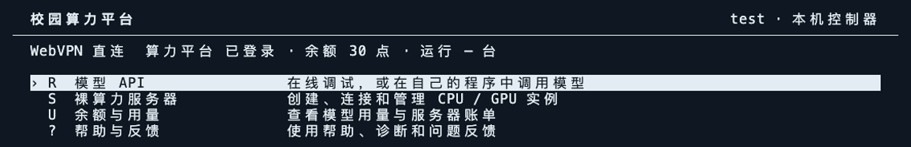

# 快速开始

想给现成的模型发一条消息？用**模型 API**。想把自己的代码放到 GPU 上跑？用 **GPU 实例**。两者从同一个工作台进入，安装和登录只需做一次。本页先带你看见自己可以使用的资源，全程只做查询。

## 1. 安装并打开工作台

准备好有平台使用权限的北邮账号和用于扫码的手机。在 macOS、Linux 或 WSL2 的终端运行以下命令，支持 x86_64 和 arm64。

```sh
curl -fsSL https://github.com/ppppangu/bupt-cli/releases/latest/download/install.sh | sh
```

看到安装成功的提示后，**新开一个终端**，运行：

```sh
bupt tui
```

屏幕会切换到「校园算力平台」。用方向键选择，Enter 打开，Esc 返回，q 退出。如果旧终端找不到命令，可直接运行 `~/.local/bin/bupt tui`。

<details>
<summary>离线安装或使用 WSL2</summary>

已有 ZIP 安装包时，完整解压，在包含 `install.sh` 的目录运行 `sh ./install.sh`。Windows 用户在 WSL2 的 Linux 终端中运行同样的安装命令。首次设置提示无法启动用户服务时，在工作台选择「作为本机进程启动」。

</details>

## 2. 登录校园账号

在首页选择「首次设置这台电脑」，按提示创建个人工作区。以后 bupt 会在这里记住你的登录会话和任务。接着选择「登录学校账号」，按手机提示完成认证。如果先出现 WebVPN 码，确认后再扫统一身份认证码。已有会话仍有效时会跳过对应步骤。

## 3. 做一次只读查询

回到首页，选与你要做的事相符的一行。**看见列表，就是这次快速开始的完成标志。**



<table data-view="cards">
  <thead><tr><th></th><th></th><th data-hidden data-card-target data-type="content-ref"></th></tr></thead>
  <tbody>
    <tr><td><strong>我想用现成的模型</strong></td><td>按 R →「模型与价格」。看到模型名称和价格后，可以试着发一条消息。</td><td><a href="models.md">完成第一次对话</a></td></tr>
    <tr><td><strong>我想运行自己的代码</strong></td><td>按 S →「资源与价格」。看到可申请的模板和配额后，再选一台适合实验的机器。</td><td><a href="gpu.md">申请并连接 GPU 实例</a></td></tr>
  </tbody>
</table>

到这里可以退出工作台，下次用 `bupt tui` 回来。如果还拿不准该选哪条路线，先读[模型调用与 GPU 实例](concepts/resources.md)。如果由工具代你运行 shell，直接看 [AI agent 登录与查询](agents.md)。
