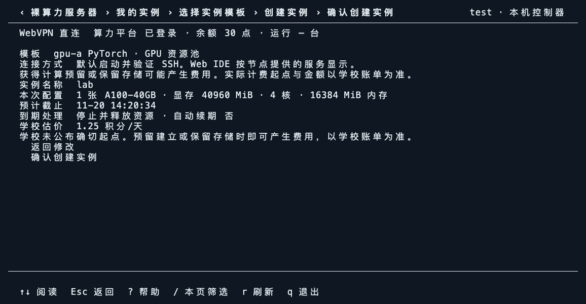

# GPU 实例：申请并连接

这一条路线从一台叫 `lab` 的实例开始：先验证你能登录，再决定是上传代码还是结束实验。需要校园账号有可用算力配额。[模型调用与实例的区别](../../he-xin-gai-nian/resources.md)

## 选规格并确认费用

运行 `bupt tui compute`，打开「资源与价格」查看模板和配额。回到「裸算力服务器」，选择「创建实例」，选定模板后把实例命名为 `lab`。若已用过这个名字，选一个新名字，并在后续示例里一并替换。

在申请表中核对 GPU、学校日价、运行上限和到期处理。要完成本教程，请选择会启动实例并准备 SSH 的创建方式。下图的报价来自模拟演示，实际提交以你当前看到的学校报价为准。



确认提交后保存**操作 ID**，它用于跟踪本次申请。若还在审批或排队，可稍后回到「我的实例」查看。此时重新创建会发起另一笔申请。

## 验证 SSH 已就绪

实例详情出现「连接 SSH」后即可进入。命令行用户在**本机**依次执行：

```sh
bupt compute instance wait lab
bupt ssh lab
```

连上后，在**远端**执行 `hostname`，会看到实例的主机名。输入 `exit` 回到本机。退出连接后，实例仍可继续运行；若平台已启动但 SSH 尚未就绪，按[连接排错](../../can-kao-yu-pai-cuo/troubleshooting.md)检查。

**现在选下一步。** 要跑代码，保留这台已就绪的实例，继续[上传代码并运行后台作业](jobs.md)。如果只为验证连接，直接[结束实验并归还算力](release.md)。
