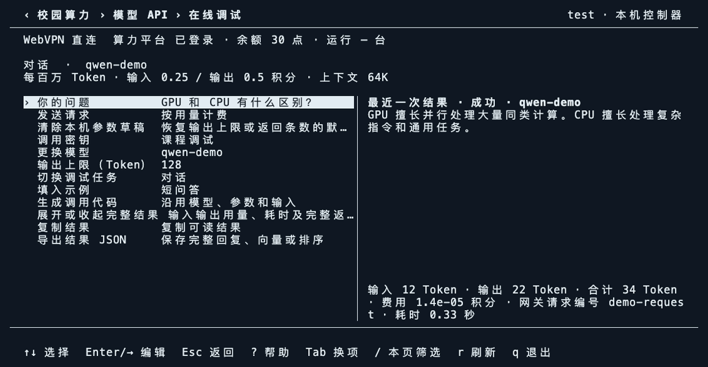

# 模型 API：完成第一次对话

已经在[快速开始](../../)看到模型目录后，可以直接试用学校部署的模型。这个练习只发一条消息。浏览目录和编辑问题都不会调用模型，选择「发送请求」时才按用量计费。

## 选对模型和密钥

打开 `bupt tui api`，在「模型与价格」里找一个支持**对话**的模型，记下调用 ID，查看输入和输出价格。向量模型适合把文本转换成数值向量，重排模型适合给候选文本排序；这个练习需要能直接回答问题的对话模型。

打开「API 密钥」。如果已经有一把允许调用该模型、且由当前控制器保管的 Key，就用它。第一次用时可以新建一把，起名如 `research`，勾选刚刚选择的模型。工作台可以代你使用已保管的完整密钥。[密钥与校园账号的关系](../../he-xin-gai-nian/access.md)

## 发送一个问题

1. 回到「模型 API」，进入「在线调试」→「对话」，选择刚才的模型。
2. 选中「你的问题」，按 Enter 编辑，输入「GPU 和 CPU 有什么区别？」。按 Esc 保留草稿，选择刚才的调用密钥。
3. 核对模型和问题，选「发送请求」。完成后，工作台会在同一页显示回答，以及网关提供的 Token 用量。

要把同一个问题放进自己的程序，在当前页选择「生成调用代码」，继续[程序接入](model-code.md)。若请求超时、平台提示结果未知，先[查看近期用量](../../can-kao-yu-pai-cuo/usage.md)再决定是否重发。
