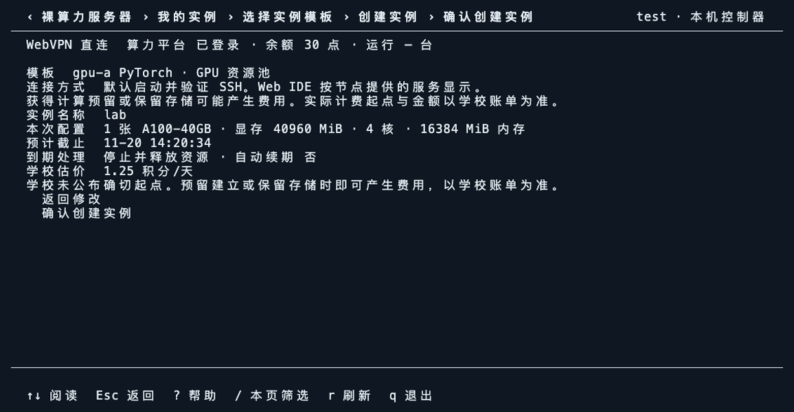

# GPU 实例

这条路线从一台叫 `lab` 的实例开始：先选规格、核对费用，再验证能登录，然后决定是上传代码跑作业，还是直接收尾。需要校园账号有可用的算力配额。模型调用和这里的区别见[核心概念](concepts.md)。

## 选规格并确认费用

运行 `bupt tui compute`，打开「资源与价格」看模板和配额。回到「裸算力服务器」，选「创建实例」，选好模板后把实例命名为 `lab`——如果这个名字已经被占用，换一个新的，并在后面的命令里一起替换。

申请表里要核对 GPU、学校日价、运行上限和到期处理。跟着这篇教程走的话，选一种会启动实例并准备好 SSH 的创建方式。下面这张报价图来自模拟演示，实际提交时以你看到的学校报价为准。



提交之后把返回的**操作 ID** 存下来，跟踪这次申请要用它。还在审批或排队的话，过会儿回「我的实例」看看就行；这时候再创建一次，会发起另一笔新申请。

## 验证 SSH 已就绪

实例详情里出现「连接 SSH」就能进去了。命令行用户在**本机**依次执行：

```sh
bupt compute instance wait lab
bupt ssh lab
```

连上之后，在**远端**执行 `hostname`，能看到实例的主机名，输入 `exit` 回本机。退出连接不影响实例继续跑；要是平台已经显示启动、但 SSH 还没就绪，照[常见问题](troubleshooting.md)排查。

## 上传代码并运行后台作业

继续用上一步验证过 SSH 的 `lab`。**作业**是这台机器上跑的一次程序，有自己的输出和退出码。下面用 Python 3 打印主机名并写进作业日志——远端实例需要先装好 Python 3。

### 1. 从本机送一份代码到实例

在本机的空目录里新建 `hello_bupt.py`，两行就够：

```python
import socket
print("running on", socket.gethostname())
```

在这个目录运行：

```sh
bupt cp ./hello_bupt.py lab:hello_bupt.py
bupt exec lab -- ls -l hello_bupt.py
```

`lab:` 表示实例上的路径。先确认远端能看到这个文件，再提交作业，这样能把「没传上去」和「程序本身跑失败」分开排查。

### 2. 提交并保存作业 ID

提交前先在实例详情核对剩余运行时间和清理策略——这个作业沿用当前托管周期，如果策略里包含停机或释放，作业结束后控制器就会开始清理。真实实验里的大文件应该提前安排写到持久存储。

```sh
bupt compute job run --instance lab --detach --output id -- python3 hello_bupt.py
```

输出的那一行就是**作业 ID**，记下来。最后一个 `--` 后面是远端要跑的程序；用了 `--detach`，提交完就能关掉本地终端。

### 3. 在新终端查看结果

换一个终端，只要用的是同一个工作区和账号，把下面的 `JOB_ID` 换成刚保存的 ID：

```sh
bupt compute job wait JOB_ID --json
bupt compute job logs JOB_ID
```

日志里出现 `running on` 和实例的主机名，说明代码确实在实例上跑起来了。作业跑得久的话，可以用 `bupt compute job logs JOB_ID --follow` 盯实时输出，Ctrl+C 结束查看。等待超时或者连接断了响应不明，参照[常见问题](troubleshooting.md#终端断开任务还在吗)处理。

## 结束实验并归还算力

先运行 `bupt compute instance show lab`。如果托管策略已经自动停机并释放了计算预留，核对一下状态和账单就行；作业还在跑的话，先确认可以中断，再往下操作。

| 实验结束后的打算 | 应该怎么做 |
| --- | --- |
| 马上接着用同一台机器 | 退出 SSH、保留运行，留意托管截止时间和费用 |
| 先暂停，但保留已分配的算力 | 停机——计算预留和磁盘可能还在计费 |
| 归还 GPU，暂时留着实例磁盘 | 先停机再释放计算预留，磁盘受学校回收策略约束 |

还需要取文件的话，趁 SSH 还能用先下载。比如程序生成了 `result.txt`，可以运行 `bupt cp lab:result.txt ./result.txt`；上一步的作业日志里也写着机器名，直接按作业 ID 查就行。

`lab` 还在运行、并且确定要归还的话，在本机依次执行，等前一步成功再执行下一步：

```sh
bupt compute instance stop lab --wait
bupt compute instance release lab --wait
bupt compute instance show lab
```

已经停机、只是还有预留的话，从第二条命令开始就行。最后确认实例**已停机、计算资源已归还**；如果状态是 `cleanup_pending`，查一下学校登录状态和当前预留，等控制器继续核对。磁盘存储可能还在计费，重要数据记得另存。[查看余额和账单](usage.md)
