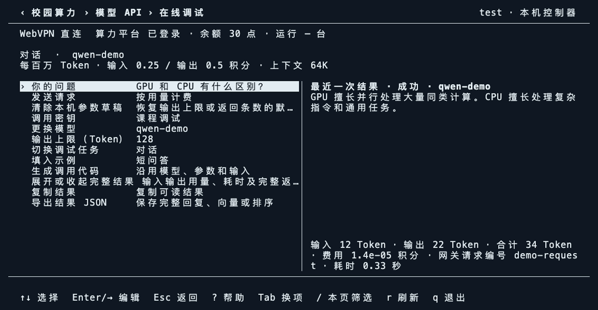

# 模型 API

在[快速开始](README.md)里你已经看过模型目录，这一页先发一条消息，再把同样的调用接进自己的程序。浏览目录和编辑问题都不计费，只有选「发送请求」才会产生一次调用。

## 选对模型和密钥

打开 `bupt tui api`，在「模型与价格」里找一个支持**对话**的模型，记下它的调用 ID，顺便看一眼输入输出价格。向量模型负责把文本转成数值向量，重排模型负责给候选文本排序——这次练习要的是能直接回答问题的对话模型。

打开「API 密钥」。如果已经有一把能调用这个模型、且归当前控制器托管的 Key，直接用；第一次用的话新建一把，起个名字比如 `research`，勾选刚才选的模型。工作台可以代你使用托管的完整密钥，不用自己抄一遍。这把 Key 和校园账号到底是什么关系，见[核心概念](concepts.md)。

## 发送一个问题

1. 回到「模型 API」，进入「在线调试」→「对话」，选刚才那个模型。
2. 选中「你的问题」，按 Enter 编辑，输入「GPU 和 CPU 有什么区别？」。按 Esc 可以先保留草稿，再选刚才那把调用密钥。
3. 核对模型和问题没错之后，选「发送请求」。回答会在同一页显示出来，旁边带着网关返回的 Token 用量。



## 接入自己的程序

在结果页选「生成调用代码」，会沿用刚才的模型、问题和参数；已经知道模型 ID 的话，也可以直接从「模型 API → 在我的程序中调用」开始。生成和预览代码都不会真的发请求。

1. 选 Python 或 curl，再选一把允许这个模型的 Key。打开「环境配置与依赖」能看到示例需要哪些环境变量。
2. 在终端运行 `bupt api key`，找到这把 Key 的 ID。把下面的 `KEY_ID` 换成实际 ID，在自己的私有目录里用一个全新文件名导出完整密钥：

   ```sh
   bupt api key export KEY_ID --file ./research.key
   export BUPT_API_KEY="$(cat ./research.key)"
   ```

3. 回到工作台，关掉「环境配置与依赖」看代码正文。按 `s` 保存，比如把 Python 示例存成 `ask.py`。切到刚才设好环境变量的终端，进入文件所在目录，运行 `python3 ask.py`。

收到模型返回的内容就说明接入成功了。每跑一次示例都会产生一次新调用，记得把导出的密钥文件放好，别带进代码仓库。想核对这次花了多少，看[余额和账单](usage.md)；请求超时或者平台提示结果未知时，参照[常见问题](troubleshooting.md#终端断开任务还在吗)处理，别急着重发。
